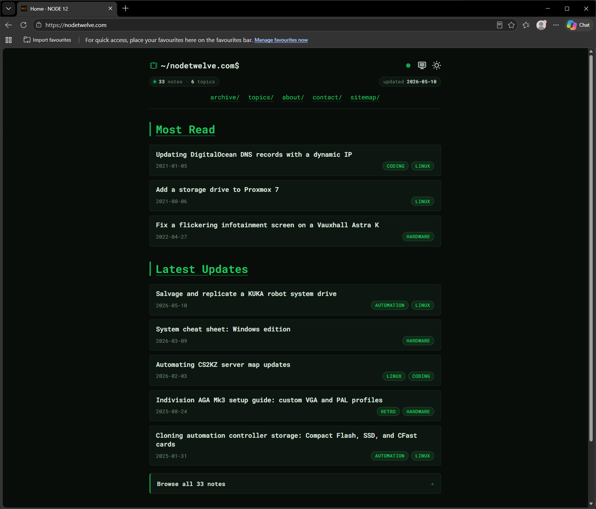
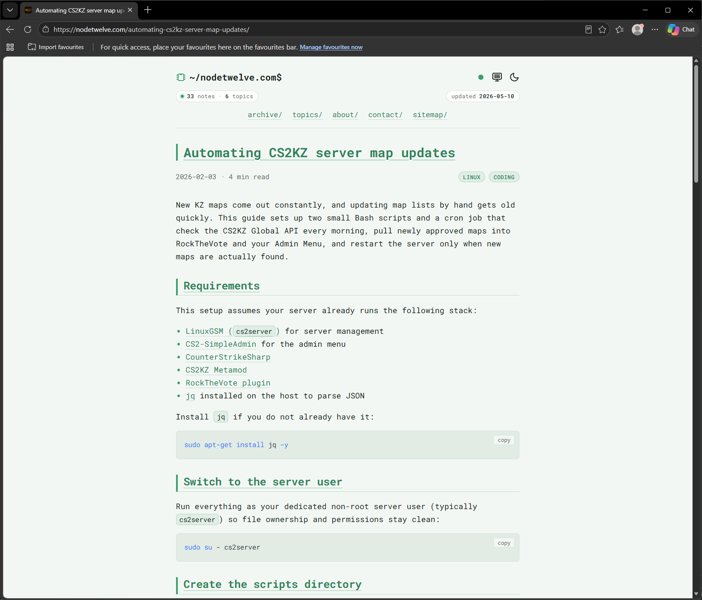
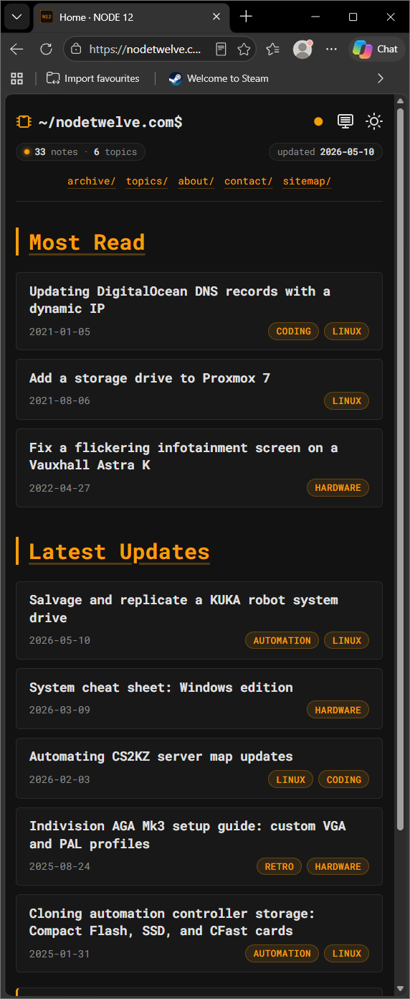
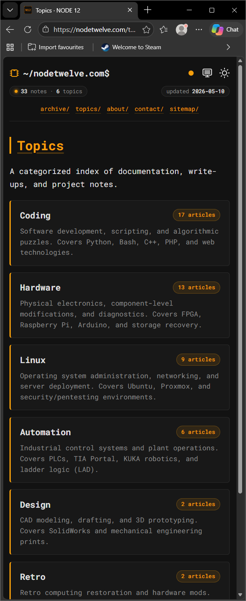
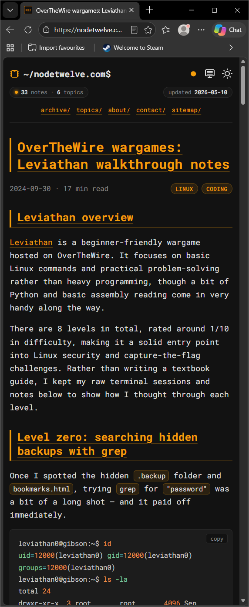
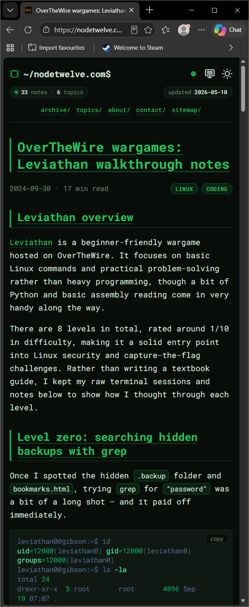
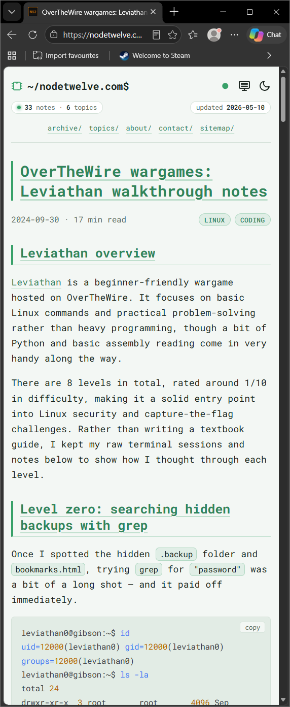
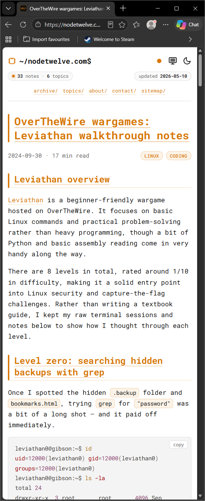

# eleventy-silicon

A fast, minimalist monospace [Eleventy 3](https://www.11ty.dev/) theme designed for personal technical notebooks, engineering documentation, and hardware blogs.

Zero CSS frameworks, zero third-party fonts, zero analytics, and automatic AVIF/WebP image optimisation — built to score 99–100 on Lighthouse out of the box.

## Screenshots

### Desktop

| Front Page (Dark Orange) | Article View |
| --- | --- |
|  |  |

### Mobile Views

| Front Page | Topics Directory | Article View |
| --- | --- | --- |
|  |  |  |

### Built-in Colour Palettes

| Dark Green | Light Green | Light Orange |
| --- | --- | --- |
|  |  |  |

## Features

- **4 built-in colour palettes + CRT scanlines:** Dark/Light theme toggle paired with **Orange** / **Green** terminal accents and an optional retro CRT scanline overlay — persisted in `localStorage` and automatically synced with PrismJS code themes.
- **Self-hosted `Roboto Mono` WOFF2 fonts:** Zero external font requests, instant rendering, GDPR-friendly.
- **Most Read + Latest Updates homepage:** Hand-pick featured posts via `src/_data/featured.json`, followed by the 5 newest notes and a full-width archive link.
- **Full-row clickable cards with soft topic pills:** Clicking anywhere on an article row opens the note while right-aligned topic pills filter directly to that topic.
- **Slim terminal status strip:** Automatically displays total notes, topic count, and most recent publish date.
- **Instant client-side Archive search:** Filter all posts live by title or topic with zero dependencies.
- **Structured Topics & Site Map directories:** Topic cards with live article counters, plus a 3-section `/sitemap/` (Pages & Endpoints grid, Topics pills, alphabetical Articles index).
- **Reading time & Older/Newer post navigation:** Automatic `~X min read` calculation and adjacent-post navigation cards.
- **Automatic image optimisation:** `@11ty/eleventy-img` converts local images into responsive `<picture>` elements (`AVIF`, `WebP`, and fallback formats).
- **Hardware-themed SVG touches:** Custom NMOS 6502 DIP-chip `404.html` page and customisable DIP-12 microchip sign-off SVG on `/about/`.
- **Zero-backend Contact page:** Copyable email card, GitHub link, and client-side `mailto:` quick message composer.

## Quick start

Requirements: **Node.js 18+** (20 LTS recommended).

```bash
git clone https://github.com/SpawnTerror/eleventy-silicon.git
cd eleventy-silicon
npm ci

# Local development server with live reload
npm start

# Production static build (outputs to _site/)
npm run build
```

Deploy the contents of `_site/` to nginx, Caddy, Cloudflare Pages, Netlify, or GitHub Pages.

### Sample nginx server block

```nginx
server {
    listen 443 ssl http2;
    server_name example.com;

    root /var/www/eleventy-silicon/_site;
    index index.html;

    error_page 404 /404.html;

    location ~* ^/(img|fonts|css)/ {
        expires 30d;
        add_header Cache-Control "public, immutable";
        try_files $uri =404;
    }

    location / {
        try_files $uri $uri/ =404;
    }
}
```

## Customising the theme

1. **Site identity (`src/_data/site.json`):** Change `name`, `domain`, `url`, `prompt`, `email`, `github`, and the `about.md` DIP-chip silkscreen text (`chipTitle`, `chipRev`, `chipSub`).
2. **Featured / Most Read posts (`src/_data/featured.json`):** List the permalinks of the 3–5 articles you want pinned above **Latest Updates**.
3. **Topics (`src/tags-index.njk` & `src/sitemap.md`):** Edit the topic list and descriptions to match your own categories.
4. **Adding a new post:** Create `src/posts/YYYY-MM-DD-your-slug.md` and put its images inside `src/images/YYYY-MM-DD-your-slug/`.

## Markdown & formatting reference

### Front matter

```yaml
---
title: "Your article title"
date: 2026-05-01
permalink: "/your-article-slug/"
layout: layouts/post.njk
tags: ["Linux", "Hardware"]
description: "Short meta description for search engines."
---
```

### Headings
- Front matter `title` automatically generates the page `<h1>`.
- Use `##` for main sections and `###` for subsections (every heading automatically receives a clickable anchor link).

### Images
Store post images inside `src/images/YYYY-MM-DD-slug/` and reference them with relative paths:

```markdown

```

Eleventy automatically converts them to responsive `AVIF` and `WebP` `<picture>` elements on build.

### Callout boxes

```markdown
::: tip
Helpful tip or shortcut.
:::

::: info
Extra background context or hardware specs.
:::

::: caution
Double-check backups, pinouts, or paths before continuing.
:::

::: warning
Destructive action or voltage warning.
:::
```

### Code blocks & inline code
- Inline code: wrap with single backticks, e.g. `` `systemctl reload nginx` ``.
- Fenced code blocks automatically get PrismJS syntax highlighting and a one-click **copy** button:

````markdown
```bash
sudo nginx -t && sudo systemctl reload nginx
```
````

### Collapsible spoiler blocks

```html
<details class="spoiler-block">
<summary>Click to expand output</summary>

Hidden notes, long logs, or benchmark tables go here.

</details>
```

### Blockquotes

```markdown
> "Everything proceeds mathematically..."
>
> &mdash; **Gottfried Wilhelm Leibniz**
```

## Project structure

```text
.
├── .eleventy.js              # Eleventy config, callouts, readingTime, image pipeline
├── package.json
└── src/
    ├── _data/
    │   ├── site.json         # Site title, domain, prompt, contact info
    │   └── featured.json     # Hand-picked Most Read permalinks
    ├── _includes/
    │   ├── css/main.css      # All styles & 4 theme palettes (inlined in <head>)
    │   └── layouts/
    │       ├── base.njk
    │       └── post.njk
    ├── css/prism/            # Matching light/dark orange/green Prism themes
    ├── fonts/                # Self-hosted Roboto Mono WOFF2 files
    ├── images/               # Post images (optimised at build time)
    ├── files/                # Static passthrough downloads (PDFs, configs, etc.)
    ├── posts/                # Markdown articles (YYYY-MM-DD-slug.md)
    ├── index.njk             # Homepage (Most Read + 5 Latest)
    ├── archive.njk           # Full archive with instant filter
    ├── tags-index.njk        # /topics/ directory with live counts
    ├── tags.njk              # /tags/<topic>/ filtered lists
    ├── sitemap.md            # Human-readable /sitemap/ directory
    ├── about.md              # About page with customisable DIP-chip SVG
    ├── contact.njk           # Contact cards + client-side mailto composer
    └── 404.njk               # NMOS 6502 hardware-bug 404 page
```

## License

[MIT](./LICENSE)
